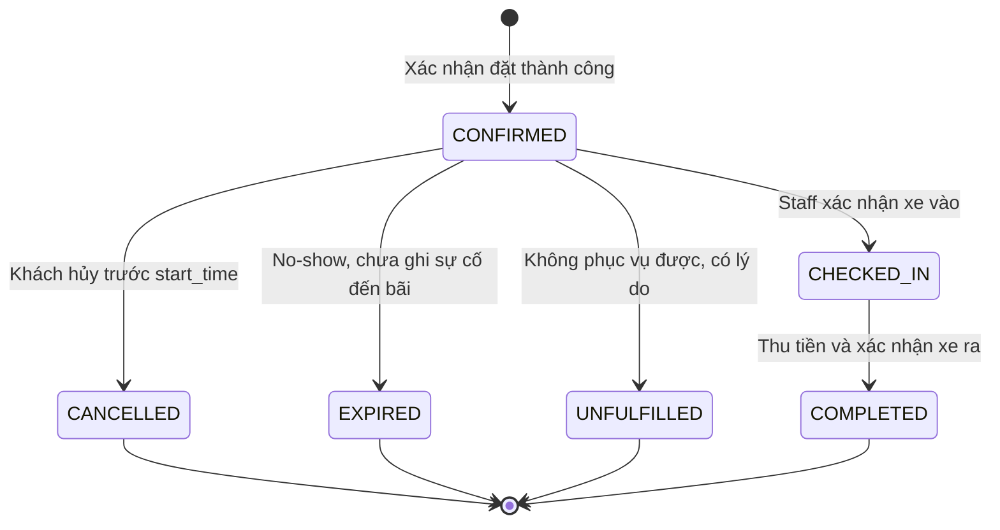
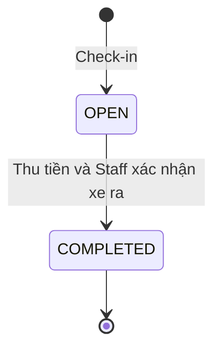

# PHÂN TÍCH ĐỀ TÀI: QUẢN LÝ BÃI ĐỖ XE TRỰC TUYẾN

**Bản thiết kế cập nhật ngày 11/10/2026.** Các quy tắc MVP trong tài liệu là cơ sở triển khai; những mục nâng cao chỉ thực hiện sau khi luồng cốt lõi đã đúng. Đây là đặc tả thiết kế, không xác nhận các chức năng đã được cài đặt hoặc kiểm thử.

---

## 1. XÁC ĐỊNH BẢN CHẤT ĐỀ TÀI

**Tên đề tài chính thức: Quản lý bãi đỗ xe trực tuyến.**

**Mục tiêu:** Xây dựng ứng dụng web quản lý hoạt động của một đơn vị vận hành nhiều bãi đỗ xe, phục vụ xe máy và ô tô. Hệ thống hỗ trợ khách hàng xem khả dụng và đặt chỗ trước; nhân viên ghi nhận xe vào/ra, thu tiền; quản trị viên cấu hình bãi và theo dõi vận hành.

**Vấn đề cần giải quyết:**

1. Khách hàng thiếu thông tin về vị trí còn phục vụ được theo loại xe và khung giờ.
2. Nhân viên xử lý thủ công, khó đối chiếu đặt chỗ với xe thực tế và phát hiện trùng vị trí.
3. Thời gian gửi, mức phí và lịch sử thu tiền thiếu nhất quán, khó đối soát.
4. Quản trị viên thiếu dữ liệu tập trung về tình trạng bãi, lượt xe và doanh thu đã thu.

**Đối tượng:** Khách hàng, nhân viên vận hành tại bãi được phân công và quản trị viên. Không xây dựng mô hình nhiều chủ bãi độc lập hoặc sàn kết nối chủ bãi trong phạm vi đồ án.

**Định vị đề tài:** Đây là hệ thống quản lý và vận hành bãi đỗ xe trên web, có tích hợp nghiệp vụ đặt chỗ. CRUD bãi/khu vực/vị trí là nền tảng; phần xử lý chính nằm ở quản lý khả dụng theo thời gian, đối chiếu lịch đặt với xe thực tế, kiểm soát đồng thời và tính phí nhất quán.

**Ý nghĩa của “trực tuyến”:** Các vai trò sử dụng ứng dụng qua trình duyệt, dữ liệu được lưu tập trung và truy cập thông qua API có xác thực. Không có nghĩa bắt buộc thanh toán ngân hàng online, cảm biến phần cứng hoặc cập nhật tức thời bằng WebSocket. MVP cập nhật gần thời gian thực bằng polling theo mục 13.

**Định nghĩa dùng trong báo cáo:**

> “Xây dựng hệ thống Quản lý bãi đỗ xe trực tuyến hỗ trợ quản lý bãi, khu vực, vị trí và phương tiện; cho phép khách hàng tra cứu khả dụng và đặt chỗ theo khung giờ; hỗ trợ nhân viên xử lý xe vào/ra, đối chiếu lượt đặt, tính phí và ghi nhận thanh toán; cung cấp dữ liệu vận hành và báo cáo cho quản trị viên.”

**Vòng đời chính:** Tìm chỗ → đặt chỗ (nếu có) → check-in → gửi xe → tính phí → thanh toán → xác nhận xe ra → lịch sử/hóa đơn. Walk-in đi vào cùng quy trình vận hành từ bước check-in, không cần tạo đặt chỗ giả.

**Phạm vi Đồ án 4:** Ưu tiên hoàn thành luồng nghiệp vụ và kiểm thử dữ liệu đúng; chức năng nâng cao được đánh dấu riêng. Mức đáp ứng môn học phải đối chiếu yêu cầu của giảng viên, không suy ra từ số màn hình hoặc điểm tự chấm.

---

## 2. ACTOR / VAI TRÒ

### 2.1. Khách hàng (Customer)
- Là ai: người có nhu cầu gửi xe, có thể có nhiều phương tiện.
- Cần làm gì: tìm bãi, xem chỗ trống, đặt chỗ, quản lý phương tiện, xem lịch sử, thanh toán.
- Được phép: tự quản lý tài khoản, phương tiện, đặt/hủy chỗ của chính mình, thanh toán.
- Không được phép: xem/sửa dữ liệu của khách khác, can thiệp vào cấu hình bãi, xác nhận xe vào/ra (đó là việc của nhân viên).

### 2.2. Nhân viên (Staff)
- Là ai: người trực tại bãi, xử lý xe vào/ra thực tế.
- Cần làm gì: check-in xe (đối chiếu đặt chỗ hoặc gán chỗ mới), check-out, xác nhận thanh toán tại chỗ nếu có.
- Được phép: vận hành tại bãi được phân công, tra cứu, check-in/check-out, xác nhận thu tiền, bảo trì theo điều kiện và xử lý sự cố có ghi vết.
- Không được phép: cấu hình giá, tạo/xóa bãi, xem báo cáo toàn hệ thống, quản lý tài khoản người dùng.

### 2.3. Quản trị viên (Admin)
- Là ai: người quản lý toàn bộ hệ thống.
- Cần làm gì: cấu hình bãi, khu vực, vị trí, giá; quản lý người dùng/nhân viên; xem báo cáo, thống kê.
- Được phép: toàn quyền cấu hình và xem dữ liệu tổng hợp.
- Không được phép: (về nguyên tắc) trực tiếp thao tác nghiệp vụ vào/ra xe — đó là việc vận hành của nhân viên, admin chỉ giám sát.

**Về vai trò không cần thiết:** Không nên tách thêm "chủ bãi xe" (Owner) làm vai trò riêng nếu đồ án chỉ giả định một đơn vị vận hành nhiều bãi — vai trò Admin đã bao quát đủ. Cũng không cần vai trò "bảo vệ" tách biệt với "nhân viên" vì trong phạm vi đồ án, hai công việc này có thể gộp làm một (Staff).

| Vai trò | Chức năng chính | Quyền hạn |
|---|---|---|
| Customer | Đặt chỗ, quản lý phương tiện, xem lịch sử, thanh toán | Chỉ trên dữ liệu của bản thân |
| Staff | Check-in/check-out xe, gán vị trí, tra cứu lượt gửi | Thao tác vận hành tại bãi được phân công |
| Admin | Cấu hình bãi/khu vực/vị trí/giá, quản lý người dùng, xem báo cáo | Toàn quyền cấu hình & xem dữ liệu tổng hợp |

---

## 3. PHÂN TÍCH NGHIỆP VỤ TOÀN TRÌNH

### 3.1. Quy trình khách hàng

Đăng ký/đăng nhập → thêm phương tiện → chọn bãi, phương tiện và thời gian → xem vị trí khả dụng → xác nhận đặt chỗ → nhận mã đặt chỗ → đến bãi → nhân viên check-in → gửi xe → xem phí → thanh toán tại quầy → nhân viên xác nhận xe ra → nhận hóa đơn/lịch sử.

- Phiên bản đầu thanh toán tại quầy: khách trả tiền mặt hoặc thao tác thanh toán mô phỏng dưới sự xác nhận của Staff. Không thu tiền trước khi đặt, không có công nợ và hoàn tiền trong MVP.
- Khách có thể hủy reservation còn CONFIRMED trước giờ bắt đầu. Khách chưa có tài khoản vẫn có thể gửi theo luồng walk-in.
- Thời gian phải được chọn trước khi truy vấn khả dụng và chọn vị trí. Chọn xe cụ thể thuộc tài khoản, không chỉ chọn loại xe.
- Giao diện cho phép chọn vị trí mong muốn. Nếu có sự cố vận hành, Staff chỉ đổi sang vị trí phù hợp cùng bãi khi khách đồng ý; nếu không phục vụ được phải ghi nhận rõ kết quả.
- Gia hạn thời gian dự kiến là SHOULD HAVE; chỉ được gia hạn nếu không ảnh hưởng lịch đặt tiếp theo. Xe ở quá giờ vẫn cần được ghi nhận và xử lý theo mục 8.

### 3.2. Quy trình xe vào bãi

**Có reservation:**
1. Staff tra mã đặt chỗ/biển số trong bãi được phân công, đối chiếu phương tiện và thời gian.
2. Backend kiểm tra reservation còn hiệu lực, chưa tạo session, bãi/khu vực/vị trí đang hoạt động, đúng loại xe, chưa có xe tại vị trí thực tế và now >= buffer_until nếu mốc đệm khác null.
3. Check-in sớm tối đa 15 phút, chỉ khi không xung đột lịch sử dụng khác trong khoảng từ giờ vào thực tế đến giờ kết thúc dự kiến cộng khoảng đệm. Khi kiểm tra lịch phải loại chính reservation đang được check-in, nhưng không loại các reservation khác trên slot đó.
4. Trong một transaction: tạo ParkingSession với biển số, loại xe và đơn giá được chụp tại thời điểm vào; chuyển Reservation sang CHECKED_IN; chuyển vị trí thực tế sang OCCUPIED; ghi nhân viên vào bãi.
5. Vị trí thực tế có thể khác vị trí khách đặt nếu có sự cố và khách đồng ý. Lưu cả vị trí đặt ban đầu trong Reservation và vị trí thực tế trong Session, cùng lý do đổi trong AuditLog.

**Walk-in:**
1. Staff nhập biển số và loại xe; không bắt buộc tạo tài khoản khách.
2. Trong MVP chỉ gán vị trí có accepts_reservations = false, đang AVAILABLE, đã hết khoảng đệm, đúng loại xe và đang hoạt động. Nhóm vị trí này dành cho walk-in và không xuất hiện trong danh sách đặt trước.
3. Tạo Session không gắn Reservation; vehicle_id/customer_id được để trống nếu là khách vãng lai. Nếu chọn phương tiện đã đăng ký, backend lấy chủ xe và loại xe từ dữ liệu đã xác minh.
   Không mở walk-in nếu cùng biển số có reservation CONFIRMED còn hiệu lực chưa giải quyết; hướng dẫn khách dùng lượt đặt hoặc hủy đúng điều kiện trước. Kiểm tra cả biển số của Vehicle liên quan để không bỏ lọt khi khách không cung cấp vehicle_id.
4. Tạo Session và cập nhật vị trí trong cùng transaction. Không nhận thêm nếu hết vị trí dành cho walk-in, dù nhóm đặt trước đang có vị trí trống.

Tách nhóm vị trí là lựa chọn bảo thủ cho MVP vì chưa kiểm soát được giờ ra của walk-in. Việc dùng chung hai nhóm cần chính sách dự kiến giờ ra và xử lý quá giờ trước khi mở rộng.

### 3.3. Quy trình xe ra và thanh toán

1. Staff tra session OPEN tại bãi được phân công, bằng mã phiên hoặc biển số chuẩn hóa.
2. Backend trả thời lượng và phí dự kiến theo đơn giá đã lưu khi check-in. Xem phí không đóng phiên và không giải phóng vị trí.
3. Staff thu tiền/xác nhận thanh toán mô phỏng, kiểm tra xe sẵn sàng ra, rồi gửi yêu cầu hoàn tất check-out.
4. Backend tính lại phí tại thời điểm xác nhận trên server. Nếu khác số tiền Staff vừa xác nhận, trả số tiền mới và yêu cầu xác nhận lại; không ghi nhận thanh toán thành công với số tiền sai.
5. Trong cùng transaction: tạo Payment PAID; lưu giờ ra và phí cuối cùng; chuyển Session sang COMPLETED; chuyển Reservation liên quan sang COMPLETED; chuyển vị trí thực tế về AVAILABLE, lưu buffer_until = check_out_time + 15 phút; ghi nhân viên ra bãi. AVAILABLE chưa cho nhận xe mới trước khi hết đệm.
6. Nếu ghi thanh toán hoặc đóng phiên lỗi, rollback toàn bộ, phiên vẫn OPEN và vị trí vẫn OCCUPIED. Gửi lại cùng yêu cầu không được thu thêm tiền hoặc tạo thêm Payment.

Thời điểm Staff xác nhận xe ra là mốc giờ ra của phần mềm; MVP không đo thời điểm xe đi qua cổng bằng phần cứng. Khoảng đệm giữa các reservation hỗ trợ thời gian vận hành, không phải khoản phí thêm.

### 3.4. Quy trình đặt chỗ

| Bước | Quy tắc | Ngoại lệ |
|---|---|---|
| Chọn bãi, phương tiện, thời gian | Xe thuộc khách; start_time/end_time hợp lệ | Trả lỗi nếu sai quyền hoặc khung giờ |
| Xem khu vực/vị trí | Truy vấn theo khung giờ, loại xe, lịch đặt và vận hành | Dữ liệu trên màn hình có thể thay đổi trước khi xác nhận |
| Xác nhận | Backend kiểm tra lại và tạo CONFIRMED trong transaction có kiểm soát đồng thời | Một yêu cầu thắng; yêu cầu xung đột nhận 409 |
| Nhận mã | Trả reservation_code duy nhất và thời hạn đến bãi | Không xem thành công trước khi database commit |
| Hủy | Chỉ chủ reservation CONFIRMED, trước start_time | Không hủy khi đã check-in |
| Hết hạn | now >= start_time + 15 phút, chưa check-in, chưa ghi nhận khách đến gặp sự cố | EXPIRED; chỉ giải phóng quyền đặt của reservation đó |
| Check-in | Trong cửa sổ cho phép và có vị trí thực tế hợp lệ | Quá hạn xử lý như walk-in nếu còn chỗ, không phục hồi reservation cũ |
| Sự cố phục vụ | Khách đã đến nhưng slot chưa được giải phóng/hỏng | Đổi chỗ có đồng ý hoặc UNFULFILLED, không đánh dấu no-show |
| Hoàn thành | Sau thanh toán và Staff xác nhận xe ra | Reservation và Session đóng đồng bộ |

MVP không giữ chỗ trong lúc khách đang chọn. Giữ chỗ tạm có thời hạn là tính năng nâng cao, phải có chủ sở hữu và thời điểm hết hạn riêng; không giữ transaction database mở trong lúc khách thao tác.

---

## 4. XE MÁY VÀ Ô TÔ

**Khác biệt cốt lõi:** diện tích chiếm dụng và mức giá khác nhau → chia khu vực phục vụ theo loại xe. Trong MVP, Zone xác định MOTORBIKE hoặc CAR, không cần entity SlotType riêng.

**Đề xuất mô hình (đơn giản, đủ thực tế):**
- Mỗi **Khu vực (Zone)** có thuộc tính `loại xe phục vụ` (MOTORBIKE hoặc CAR; mỗi Zone chỉ phục vụ một loại trong MVP).
- Mỗi **Vị trí đỗ (ParkingSlot)** có thuộc tính `loại xe` kế thừa từ khu vực nó thuộc về.
- **Giá (PricingRule)** được định nghĩa riêng theo loại xe (ví dụ: xe máy 5.000đ/giờ, ô tô 20.000đ/giờ) — không cần bảng giá phức tạp theo từng vị trí.
- **Thông tin đặc thù:** xe máy chỉ cần biển số; ô tô có thể thêm thuộc tính "loại xe con/xe bán tải" nhưng **không bắt buộc** — nên giữ đơn giản: chỉ cần biển số + loại phương tiện (2 loại: MOTORBIKE, CAR) là đủ cho đồ án.
- **Không nên** làm riêng luồng đặt chỗ khác nhau cho 2 loại xe — chỉ khác ở bước lọc theo loại xe khi chọn khu vực/vị trí, logic nghiệp vụ dùng chung.

**Kết luận:** Chia theo Zone là đủ, không cần thiết kế loại "SlotType" phức tạp riêng biệt gây rối cho database.

---

## 5. CẤU TRÚC BÃI ĐỖ VÀ KHẢ DỤNG THEO THỜI GIAN

ParkingLot → Zone → ParkingSlot. Zone có thể có floor_label để thể hiện tầng; mỗi Zone chỉ phục vụ MOTORBIKE hoặc CAR. Loại xe của Slot được lấy từ Zone, không lưu thêm một loại xe độc lập dễ sai lệch.

### 5.1. Tình trạng vận hành hiện tại

| operational_status | Ý nghĩa | Cập nhật |
|---|---|---|
| AVAILABLE | Không có session OPEN, không bị bảo trì | Khi xe ra hoặc kết thúc bảo trì |
| OCCUPIED | Có một session OPEN tại vị trí | Khi Staff check-in thành công |
| MAINTENANCE | Khóa vận hành để sửa chữa/đối soát, không nhận xe hoặc đặt mới | Admin/Staff có quyền đánh dấu theo quy tắc mục 20 |

Slot còn có is_active, accepts_reservations và buffer_until nullable (mốc kết thúc khoảng đệm sau xe ra). AVAILABLE mô tả vị trí hiện không có xe; nhận xe/đặt chỗ còn phải kiểm tra loại xe, nhóm vị trí, lịch sử dụng và khoảng đệm.

Session OPEN là bằng chứng xe đang đỗ. operational_status là trạng thái được cập nhật cùng transaction và phải nhất quán với session; nếu phát hiện lệch, khóa giao dịch sử dụng vị trí để đối soát, không tự xóa session.

### 5.2. Khả dụng theo khung giờ và khoảng đệm

- Một Slot có nhiều Reservation theo thời gian. Không đổi Slot thành RESERVED toàn cục khi có người đặt trong tương lai.
- Khoảng khách đặt là [start_time, end_time). Khi Reservation còn CONFIRMED, khoảng khóa lịch dự kiến là [start_time, end_time + 15 phút). Khoảng đệm dự kiến giúp giãn các lượt trước khi có dữ liệu xe ra thực tế.
- Hai khoảng [a, b) và [c, d) xung đột khi a < d và c < b. Hai khoảng chỉ chạm đầu/cuối không xung đột.
- Khi CHECKED_IN, Session OPEN khóa vị trí thực tế. Không tự kết thúc session hoặc giải phóng vị trí khi tới end_time.
- Giới hạn MVP: Slot có Session OPEN không nhận reservation mới cho bất kỳ khung giờ nào đến khi session đóng. Những reservation tương lai đã xác nhận trước đó vẫn tồn tại; xe hiện tại quá giờ phải được xử lý theo mục 8. Đây là lựa chọn an toàn cho phiên bản đầu, không phải quy tắc tối ưu đặt lịch tương lai.
- CANCELLED, EXPIRED và UNFULFILLED không khóa lịch, không tạo khoảng đệm mới. Hủy/hết hạn chỉ bỏ quyền đặt của bản ghi đó, không thay đổi OCCUPIED hoặc xóa lịch khác.
- Khi check-out thành công, Reservation chuyển COMPLETED và thôi khóa khoảng dự kiến. Slot thực tế chuyển AVAILABLE, đồng thời lưu buffer_until = check_out_time + 15 phút trong cùng transaction. Khoảng đệm thực tế thay thế khoảng dự kiến của lượt đã hoàn thành.
- Trong [check_out_time, buffer_until), không nhận check-in/walk-in và không nhận reservation mới có khoảng gửi chồng thời gian đệm. Reservation đã xác nhận cho lượt tiếp theo vẫn tồn tại; nếu khách đến khi chưa hết đệm, Staff xử lý chờ/đổi chỗ/sự cố theo mục 8.
- Mốc buffer_until còn hiệu lực dù Session/Reservation trước đã COMPLETED, kể cả walk-in không có Reservation. Tại now = buffer_until được xét nhận xe nếu các điều kiện khác thỏa mãn.
- Không xóa buffer_until khi hủy một reservation, kết thúc bảo trì hoặc retry check-out. Không cần job đổi trạng thái khi hết đệm: truy vấn so sánh giờ server với mốc đã lưu.

Ví dụ lịch CONFIRMED 08:00–10:00 khóa dự kiến đến 10:15. Nếu xe ra thực tế 10:00, mốc buffer_until là 10:15: đặt/check-in lúc 10:05 bị từ chối, lúc 10:15 được xét. Nếu xe ra sớm 09:00, khoảng dự kiến của lượt đó được bỏ và vị trí được xét sử dụng lại từ 09:15; nếu ra muộn 10:20, phải chờ tới 10:35 hoặc điều phối khách kế tiếp. Tiền chỉ tính đến giờ ra thực tế, không tính 15 phút đệm.

### 5.3. Hiển thị sơ đồ

Sơ đồ theo khung giờ hiển thị AVAILABLE, RESERVED, OCCUPIED, MAINTENANCE như kết quả truy vấn, kèm lý do không khả dụng. Trong sơ đồ hiện tại hoặc khi khoảng gửi đã chọn chồng thời gian đệm, hiển thị “Chờ sẵn sàng đến …” và vô hiệu hóa chọn vị trí; API trả bufferUntil và lý do BUFFER_ACTIVE, không thêm trạng thái lưu toàn cục mới. Khung giờ tương lai nằm sau buffer_until vẫn được xét, không vô hiệu hóa cả slot chỉ vì đang trong đệm hôm nay. RESERVED là nhãn suy ra từ lịch, không phải trạng thái lưu toàn cục của Slot. Sơ đồ hiện tại và sơ đồ theo thời gian phải có nhãn phân biệt, kèm thời điểm cập nhật dữ liệu.

---

### 5.4. Giả định và giới hạn của MVP

| Lựa chọn | Lợi ích | Giới hạn và hướng mở rộng |
|---|---|---|
| Chặn đặt mới trên slot có Session OPEN | Không dự đoán chắc chắn giờ xe ra | Có thể mất cơ hội đặt ngày khác; mở xét lịch tương lai sau khi có thời gian ra dự kiến và chính sách rủi ro |
| Chia slot đặt trước và walk-in | Bảo vệ lịch xác nhận khỏi lượt walk-in không có giờ ra | Có thể từ chối walk-in dù nhóm đặt trước còn trống; không tuyên bố tối ưu sức chứa |
| Xe có CONFIRMED chưa giải quyết không mở walk-in | Tránh một xe đang gửi nhưng không đến được lượt đã đặt | Kể cả lịch ngày mai; Staff phải hiển thị lịch liên quan và hướng dẫn sử dụng/hủy đúng điều kiện, không tự hủy thay khách |
| Thu tiền tại quầy và đóng phiên cùng lệnh | Giảm số trạng thái thanh toán cần xử lý | Không mô hình hóa ngân hàng thật, công nợ hoặc thu tiền trước |

Các giới hạn phải được nêu trong báo cáo và thông báo phù hợp trên giao diện. “Đặt trước” là xác nhận lịch theo quy tắc, đi kèm chính sách sự cố; không cam kết tuyệt đối luôn có đúng vị trí khi xe trước chưa ra. Dùng chung slot hoặc cho walk-in có giờ ra dự kiến là hướng mở rộng sau khi hoàn thành MVP.

---

## 6. CHỨC NĂNG HỆ THỐNG

### A. Chức năng khách hàng

| Chức năng | Mục đích | Input | Xử lý | Output | Ưu tiên |
|---|---|---|---|---|---|
| Đăng ký/Đăng nhập | Xác thực người dùng | Email/SĐT, mật khẩu | Kiểm tra, tạo/kiểm tra tài khoản | Token/phiên đăng nhập | MUST |
| Quản lý phương tiện | Lưu biển số xe của khách | Biển số, loại xe | CRUD Vehicle | Danh sách xe | MUST |
| Tìm bãi & xem chỗ trống | Chọn nơi gửi xe | Khu vực, loại xe, thời gian | Truy vấn slot trống | Danh sách bãi/khu vực/vị trí trống | MUST |
| Đặt chỗ | Giữ trước vị trí | Bãi, loại xe, vị trí, thời gian | Kiểm tra khả dụng, tạo Reservation | Mã đặt chỗ | MUST |
| Hủy đặt chỗ | Hủy khi không cần nữa | Mã đặt chỗ | Cập nhật trạng thái, bỏ lịch của reservation đó | Xác nhận hủy | MUST |
| Xem lịch sử đặt chỗ/gửi xe | Theo dõi hoạt động | — | Truy vấn dữ liệu cá nhân | Danh sách lịch sử | SHOULD |
| Thanh toán tại quầy | Trả phí gửi xe | Mã phiên gửi | Staff xác nhận thu tiền; backend tính phí và ghi Payment | Hóa đơn | MUST |
| Nhận thông báo | Nhắc lịch, cảnh báo hết hạn | — | Gửi thông báo hệ thống | Thông báo trong app | NICE |

### B. Chức năng nhân viên

| Chức năng | Mục đích | Input | Xử lý | Output | Ưu tiên |
|---|---|---|---|---|---|
| Check-in xe | Ghi nhận xe vào bãi | Mã đặt chỗ hoặc biển số | Đối chiếu Reservation hoặc gán slot mới | Tạo ParkingSession | MUST |
| Check-out xe | Thu tiền và ghi nhận xe ra | Mã phiên/biển số, phương thức thu | Tính phí và ghi Payment, đóng session trong transaction | Hóa đơn, đóng session | MUST |
| Xem trạng thái bãi | Biết còn trống bao nhiêu | — | Truy vấn slot theo trạng thái | Sơ đồ/bảng trạng thái | MUST |
| Tra cứu lượt gửi theo biển số | Hỗ trợ khi mất vé | Biển số | Tìm session đang mở | Thông tin phiên gửi | SHOULD |

### C. Chức năng quản trị viên

| Chức năng | Mục đích | Input | Xử lý | Output | Ưu tiên |
|---|---|---|---|---|---|
| Quản lý bãi/khu vực/vị trí | Cấu hình hệ thống | Thông tin bãi, zone, slot | CRUD | Danh sách cấu hình | MUST |
| Quản lý giá | Thiết lập PricingRule | Loại xe, đơn giá | CRUD | Bảng giá | MUST |
| Quản lý người dùng/nhân viên | Quản trị tài khoản | Thông tin user | CRUD, phân quyền | Danh sách người dùng | SHOULD |
| Xem báo cáo/thống kê | Theo dõi vận hành | Khoảng thời gian | Tổng hợp dữ liệu | Biểu đồ, số liệu | SHOULD |
| Đánh dấu bảo trì vị trí | Khóa vị trí hỏng | Slot ID, lý do | Kiểm tra xe/lịch đặt, cập nhật và ghi audit | Khóa vận hành | MUST |

---

## 7. CÁC CHỨC NĂNG NỔI BẬT (3–5 điểm nhấn khi thuyết trình)

1. **Đặt chỗ trước theo thời gian thực** — đây là điểm khác biệt cốt lõi so với đề tài "quản lý bãi xe" thông thường; giải quyết bài toán lịch theo thời gian, xác nhận đồng thời và hết hạn.
2. **Phân khu & xử lý riêng cho xe máy/ô tô** — cho thấy nghiệp vụ có tính thực tế hơn so với hệ thống chỉ có một loại phương tiện.
3. **Đối chiếu đặt chỗ với vận hành thực tế (check-in/check-out)** — thể hiện tính "khép kín" trọn vòng đời của một lượt gửi xe, không chỉ là app đặt lịch.
4. **Tự động tính phí theo thời gian thực tế và giữ đơn giá áp dụng; xử lý quá giờ/no-show** — đây là logic nghiệp vụ có giá trị, không phải CRUD.
5. Dashboard thống kê tỷ lệ lấp đầy/doanh thu là điểm cộng nhưng **chỉ là chức năng hỗ trợ**, không nên coi là điểm nổi bật chính vì bản thân nó chỉ là truy vấn tổng hợp.

**Nhận định:** "Hiển thị trạng thái chỗ trống" và "Quản lý lượt gửi" tự thân chỉ là CRUD/truy vấn; giá trị thực nằm ở logic xử lý đặt chỗ + đối chiếu vận hành + tính phí theo ngữ cảnh (đây mới là phần cần đầu tư chất xám khi làm báo cáo).

---

## 8. CÁC TRƯỜNG HỢP NGOẠI LỆ VÀ CHÍNH SÁCH PHỤC VỤ

| Tình huống | Cách xử lý chốt cho MVP |
|---|---|
| Hai khách đặt cùng vị trí, khung giờ xung đột | Backend kiểm tra và ghi trong transaction có kiểm soát đồng thời; chỉ một yêu cầu được commit |
| Một xe đặt hai vị trí/bãi trong cùng khung giờ | Từ chối khi reservation còn hiệu lực của cùng xe chồng giờ, dù khác slot/bãi |
| Khách không đến | Hết hạn sau 15 phút từ start_time; không phát sinh phí |
| Khách đến sớm | Sớm tối đa 15 phút; phải kiểm tra vị trí thực tế và lịch liên quan |
| Khách đến trễ | Cho check-in khi now < start_time + 15 phút; tại đúng hạn hoặc sau hạn, chuyển EXPIRED |
| Khách hủy | CONFIRMED và now < start_time; không thanh toán trước nên không có hoàn tiền trong MVP |
| Xe vãng lai chưa có tài khoản | Session có snapshot biển số/loại xe, liên kết khách và Vehicle để trống |
| Hết vị trí walk-in | Từ chối nhận/gợi ý bãi khác; không tự lấy vị trí thuộc nhóm đặt trước |
| Xe ra sớm | Tính thời lượng thực tế, tối thiểu một giờ; bỏ lịch dự kiến của lượt hoàn thành, giữ đệm đến giờ ra thực tế + 15 phút |
| Khách đến khi slot vừa có xe ra và còn đệm | Chờ hết buffer_until nếu còn trong cửa sổ check-in; nếu ảnh hưởng phục vụ, ghi sự cố hoặc đổi slot hợp lệ |
| Xe quá giờ dự kiến | Session vẫn OPEN, Slot vẫn OCCUPIED; tính phí thực tế một lần, hiển thị cảnh báo quá giờ |
| Xe trước quá giờ khi khách đặt sau đến | Ưu tiên đổi sang slot phù hợp cùng bãi, kiểm tra cả lịch trên slot thay thế và cần khách đồng ý |
| Không có slot thay thế hoặc khách từ chối đổi | Ghi khách đã đến và sự cố; kết thúc reservation bằng UNFULFILLED với lý do, Staff xử lý và thời điểm; gợi ý bãi khác, không tạo Session/Payment giả |
| Khách chờ xử lý sự cố trước hạn no-show | Staff đánh dấu service_issue_at trong transaction trước hạn; job không tự EXPIRED; phải giải quyết trong 15 phút kể từ lúc ghi nhận, bằng check-in hoặc UNFULFILLED |
| Reservation đã EXPIRED nhưng khách báo đã đến | Không phục hồi tự động; tra AuditLog, ghi sự cố và xử lý walk-in nếu còn chỗ |
| Mất vé | Tra biển số trong bãi và xác minh thủ công; không thu phí mất vé trong MVP |
| Hai session cùng biển số | Chuẩn hóa biển số và từ chối mở phiên thứ hai trên toàn hệ thống |
| Nhân viên nhập sai biển số | Cho sửa trong 5 phút đầu khi chưa checkout; kiểm tra trùng lại, ghi giá trị trước/sau và người sửa; không sửa loại xe/giá tùy ý |
| Vị trí cần bảo trì, có lịch đặt tương lai | Chặn đặt/check-in mới; xử lý từng reservation bằng đổi chỗ có đồng ý hoặc UNFULFILLED; không xóa lịch |
| Bảo trì vị trí đang có session OPEN | Từ chối thao tác bảo trì thông thường; giữ OCCUPIED, ghi sự cố để xử lý vận hành |
| Dữ liệu ghi trống nhưng thực tế có xe | Staff khóa vị trí không có session OPEN để đối soát, ghi sự cố; không nhận xe mới vào đó |
| Hai nhân viên check-in/check-out đồng thời | Chỉ một chuyển trạng thái hợp lệ; yêu cầu lặp trả kết quả cũ hoặc 409, không tạo bản ghi trùng |
| Lỗi mạng sau khi server đã commit | Gửi lại cùng Idempotency-Key hoặc tra trạng thái; không tự coi thất bại là thành công giả lập |

**Phạm vi cam kết:** Hệ thống ngăn xung đột lịch tại thời điểm xác nhận và hỗ trợ vận hành xử lý chỗ thực tế. Không cam kết tuyệt đối đúng vị trí nếu xe trước chưa ra hoặc có sự cố. Chính sách đổi chỗ và UNFULFILLED phải được hiển thị trước khi khách xác nhận đặt. Khoảng đệm 15 phút giảm rủi ro, không bảo đảm mọi xe ra đúng giờ.

---

## 9. QUẢN LÝ GIÁ, TÍNH PHÍ VÀ THANH TOÁN

### 9.1. Công thức chốt

- Mỗi loại xe có một PricingRule đang hoạt động trên toàn hệ thống; MVP dùng giá chung cho các bãi.
- MOTORBIKE: mặc định 5.000 VNĐ/giờ; CAR: mặc định 20.000 VNĐ/giờ. Đây là giá demo có thể cấu hình, không phải giá thị trường.
- billable_hours = max(1, ceil((check_out_time - check_in_time) / 1 giờ)).
- total_fee = billable_hours × applied_price_per_hour.
- Mốc giờ do server cung cấp; tiền VNĐ dùng số nguyên hoặc decimal, không dùng kiểu số thực để lưu tiền.
- Tính toàn bộ thời gian thực tế một lần. Phần quá giờ đặt đã nằm trong công thức; không cộng thêm một khoản cùng đơn giá lần thứ hai.
- Qua ngày vẫn cộng giờ liên tục. Hủy, no-show, UNFULFILLED không có Session thì không có phí gửi.

Ví dụ xe máy gửi 08:00–10:10: tính 3 giờ × 5.000 = 15.000 VNĐ, dù giờ đặt kết thúc 10:00. Khoảng đệm lịch không được cộng vào thời gian gửi thực tế.

### 9.2. Giữ nguyên đơn giá và lịch sử

Khi check-in, backend đọc PricingRule và lưu pricing_rule_id, applied_price_per_hour trong Session. Giá hiển thị lúc đặt là dự kiến; giá chính thức là giá đang áp dụng lúc vào bãi và phải được hiển thị để khách biết. Admin sửa giá chỉ ảnh hưởng phiên vào sau thay đổi, không sửa đơn giá các phiên OPEN hoặc COMPLETED.

### 9.3. Thanh toán MVP

- Customer xem phí/hóa đơn của mình và thanh toán tại quầy. Staff ghi nhận thu tiền mặt hoặc xác nhận thao tác mô phỏng; backend là nơi tính tiền và ghi Payment.
- Chỉ ghi Payment PAID khi Staff xác nhận khoản thanh toán thành công và xe ra; Payment, Session và Reservation đóng trong cùng transaction theo mục 3.3.
- Payment lưu session_id, amount, method (CASH hoặc SIMULATED), paid_at và confirmed_by_staff_id. Chưa thu tiền thì chưa có Payment thành công.
- Một Session có tối đa một Payment thành công. Không cho sửa/xóa Payment đã ghi; lỗi cần ghi sự cố đối soát trong AuditLog.
- Transaction database chỉ bảo vệ bản ghi phần mềm, không tự hoàn tác tiền mặt đã trao. Nếu đã nhận tiền nhưng ghi dữ liệu lỗi, Staff giữ thông tin thu tiền để đối soát và retry cùng yêu cầu, không thu lại từ khách. Nếu phí đổi trước commit, phải xác nhận phần chênh lệch với khách trước khi hoàn tất; đây là giới hạn của quy trình tại quầy, không phải một lần thanh toán thành công tự động.
- Thanh toán trực tuyến do Customer tự xác nhận, thu trước, hoàn tiền và công nợ thuộc phạm vi nâng cao; phải bổ sung quy trình thanh toán/đối soát trước khi triển khai.

---

## 10. DATABASE VÀ RÀNG BUỘC DỮ LIỆU

### 10.1. Entity nghiệp vụ

Giữ 9 entity nghiệp vụ chính; thêm AuditLog làm bảng hỗ trợ ghi vết. Không thêm Floor hoặc Role riêng trong MVP. Các trường dưới đây là thiết kế logic, cần chuyển thành kiểu dữ liệu, khóa và index trong ERD/migration.

| Entity | Trường chính |
|---|---|
| User | id, name, normalized_email, password_hash, phone, role, is_active, assigned_parking_lot_id nullable, created_at |
| Vehicle | id, user_id FK, plate_number, normalized_plate_number, vehicle_type, is_active, created_at |
| ParkingLot | id, name, address, is_active |
| Zone | id, parking_lot_id FK, name, floor_label nullable, vehicle_type, is_active |
| ParkingSlot | id, zone_id FK, code, operational_status, accepts_reservations, buffer_until nullable, is_active |
| Reservation | id, reservation_code, user_id FK, vehicle_id FK, slot_id FK (vị trí đặt ban đầu), plate_number_snapshot, vehicle_type_snapshot, start_time, end_time, expires_at, status, service_issue_at nullable, issue_reason nullable, resolved_by_staff_id nullable, resolved_at nullable, created_at, cancelled_at nullable |
| ParkingSession | id, session_code, reservation_id FK nullable, customer_id FK nullable, vehicle_id FK nullable, slot_id FK (vị trí thực tế), plate_number_snapshot, normalized_plate_number_snapshot, vehicle_type_snapshot, check_in_staff_id FK, check_out_staff_id FK nullable, check_in_time, check_out_time nullable, pricing_rule_id FK, applied_price_per_hour, billable_hours nullable, total_fee nullable, status, created_at |
| PricingRule | id, vehicle_type, price_per_hour, is_active, updated_at |
| Payment | id, session_id FK, amount, method, status (PAID trong MVP), paid_at, confirmed_by_staff_id FK |
| AuditLog | id, actor_user_id FK nullable (job hệ thống không có user), action, entity_type, entity_id, occurred_at, reason nullable, details_json, request_id nullable |

Mỗi Staff được phân công một bãi trong MVP; assigned_parking_lot_id bắt buộc khi role = Staff và để trống ở vai trò khác. Nhiều bãi cho một nhân viên là mở rộng qua bảng liên kết. Kiểm tra vai trò Staff của các FK nghiệp vụ tại backend.

Session walk-in vãng lai có reservation_id/customer_id/vehicle_id để trống. Session của xe có đăng ký lấy customer_id từ chủ Vehicle; session có reservation phải khớp user/Vehicle/loại xe của reservation. Snapshot bảo toàn lịch sử khi thông tin phương tiện thay đổi. Reservation.slot_id là vị trí ban đầu; Session.slot_id là vị trí sử dụng thực tế và không được tự suy ra rằng hai trường luôn bằng nhau.

AuditLog bắt buộc ghi thay đổi giá, phân công/quyền, hủy/hết hạn/không phục vụ được, đổi vị trí, sửa biển số, bảo trì và check-in/check-out. Không ghi mật khẩu hoặc token vào log. Giữ chi tiết người đồng ý đổi vị trí, vị trí cũ/mới và lý do trong log.

### 10.2. Quan hệ

- User 1—n Vehicle và Reservation; User (Staff) n—1 ParkingLot theo phân công MVP.
- ParkingLot 1—n Zone; Zone 1—n ParkingSlot.
- ParkingSlot 1—n Reservation theo lịch và 1—n ParkingSession theo lịch sử thực tế.
- Reservation 1—0..1 ParkingSession; Session có thể không có Reservation.
- User/Vehicle 1—n ParkingSession khi có liên kết; walk-in vãng lai không có liên kết này.
- ParkingSession 1—0..1 Payment thành công; phiên OPEN có 0 Payment, phiên COMPLETED có 1 Payment trong MVP.
- PricingRule 1—n ParkingSession; đơn giá snapshot trong session là nguồn tính phí lịch sử.

### 10.3. Khóa, index và điều kiện bắt buộc

- Unique normalized_email; unique normalized_plate_number của Vehicle; unique reservation_code và session_code.
- Unique (zone_id, code) của Slot; hiển thị kèm khu vực để phân biệt mã giống nhau giữa các khu vực.
- Unique reservation_id khác null trong Session để một đặt chỗ không tạo hai phiên.
- Unique session_id trong Payment để không thu tiền hai lần.
- Unique có điều kiện cho slot_id của Session OPEN và normalized_plate_number_snapshot của Session OPEN; ngăn hai xe chung slot và một xe có hai phiên OPEN trên toàn hệ thống.
- Unique vehicle_type cho PricingRule đang hoạt động. CHECK: price_per_hour > 0, end_time > start_time, amount > 0, giờ ra không trước giờ vào; giới hạn enum hợp lệ.
- Index hỗ trợ (slot_id, status, start_time, end_time), (vehicle_id, status, start_time, end_time), tra session theo biển số, slot theo buffer_until và tổng hợp Payment theo paid_at.
- Không có unique đơn giản nào trên (slot_id, start_time) đủ để ngăn mọi khoảng thời gian chồng nhau. Quy tắc này phải được kiểm tra trong transaction có cơ chế đồng bộ theo mục 19.

### 10.4. Bảo toàn lịch sử

Dùng is_active để ngừng sử dụng User/Vehicle/Lot/Zone/Slot; FK không cascade xóa Reservation/Session/Payment. Không ngừng Slot/Zone/Lot khi còn Session OPEN hoặc Reservation CONFIRMED chưa giải quyết. Không đổi loại Zone hoặc nhóm accepts_reservations khi còn lượt gửi/lịch đặt liên quan.

Không sửa biển số/loại xe hoặc ngừng Vehicle khi có reservation còn hiệu lực/session OPEN. Lịch sử vẫn dùng snapshot khi Vehicle được sửa sau khi đã kết thúc nghiệp vụ. Khóa tài khoản không xóa lịch sử hoặc đóng session; Staff vẫn được xử lý xe ra theo quy trình.

---

## 11. API / BACKEND

### 11.1. Quy ước chung

Prefix /api; tên tài nguyên và hành động dùng kebab-case, JSON dùng camelCase. Quyền được kiểm tra ở backend theo vai trò, chủ dữ liệu và bãi được phân công. Route frontend chỉ hỗ trợ trải nghiệm điều hướng, không thay thế phân quyền server.

| Endpoint | Method | Actor / nội dung |
|---|---|---|
| /api/auth/register, /api/auth/login | POST | Đăng ký Customer / đăng nhập; đăng ký không được tự chọn Staff/Admin |
| /api/auth/me | GET | User đang xác thực |
| /api/vehicles, /api/vehicles/{id} | GET/POST/PATCH | Customer quản lý xe của mình; PATCH có thể ngừng hoạt động |
| /api/parking-lots, /api/parking-lots/{id} | GET | Xem các bãi đang hoạt động |
| /api/parking-lots/{id}/availability | GET | vehicleId, startTime, endTime; trả zone/slot phù hợp khung giờ |
| /api/parking-slots | GET | Staff đúng bãi xem vận hành; lọc vehicleType, acceptsReservations và thời gian để tìm slot walk-in/thay thế |
| /api/reservations | POST | Customer gửi vehicleId, slotId, startTime, endTime |
| /api/reservations/my, /api/reservations/{id} | GET | Customer xem của mình; Staff xem trong bãi phân công; Admin giám sát |
| /api/reservations/{id}/cancel | POST | Chủ reservation; kiểm tra điều kiện hủy |
| /api/reservations/{id}/service-issue | POST | Staff ghi khách đã đến gặp sự cố trước hạn; lý do bắt buộc |
| /api/reservations/{id}/unfulfilled | POST | Staff kết thúc sự cố không phục vụ được; lý do bắt buộc |
| /api/parking-sessions/check-in | POST | Staff: reservationCode hoặc walk-in plateNumber/vehicleType; slot thay thế và lý do/đồng ý nếu có |
| /api/parking-sessions | GET | Staff: status/plateNumber trong bãi được phân công |
| /api/parking-sessions/my | GET | Customer xem phiên gắn tài khoản của mình |
| /api/parking-sessions/{id}/fee | GET | Phí dự kiến; Customer của phiên, Staff đúng bãi hoặc Admin giám sát |
| /api/parking-sessions/{id}/check-out | POST | Staff; paymentMethod, confirmedAmount, Idempotency-Key; hoàn tất thu tiền và xe ra |
| /api/parking-sessions/{id}/plate-number | PATCH | Staff sửa lỗi nhập trong 5 phút đầu, lý do bắt buộc |
| /api/payments/my, /api/payments/{id} | GET | Hóa đơn; chủ dữ liệu hoặc Staff đúng bãi/Admin |
| /api/admin/parking-lots, /api/admin/zones, /api/admin/parking-slots | GET/POST/PATCH | Admin cấu hình/ngừng hoạt động; không cho sửa OCCUPIED tùy ý |
| /api/parking-slots/{id}/maintenance | POST | Admin/Staff đúng bãi; bật/tắt bảo trì theo quy tắc |
| /api/admin/pricing-rules | GET | Admin xem giá |
| /api/admin/pricing-rules/{id} | PATCH | Admin sửa giá; ghi audit |
| /api/admin/users, /api/admin/users/{id} | GET/POST/PATCH | Admin tạo/khóa user, sửa vai trò và phân công |
| /api/admin/reports/occupancy, /api/admin/reports/revenue | GET | Admin; lọc bãi và khoảng thời gian |

MVP không có POST /api/payments độc lập: Payment được tạo bởi lệnh check-out để tránh trả tiền nhưng đóng phiên thất bại. Thanh toán online có API riêng khi bổ sung quy trình nâng cao.

### 11.2. Dữ liệu và lỗi

- Không nhận userId, staffId, đơn giá, tổng phí hoặc trạng thái hoàn thành tùy ý từ client. Actor lấy từ token, số tiền tính ở server; confirmedAmount chỉ là số tiền Staff xác nhận để đối chiếu.
- API thời gian dùng ISO 8601 có offset hoặc Z. Lưu UTC; giao diện và báo cáo chuyển sang Asia/Ho_Chi_Minh (UTC+7). Từ chối thời gian không có múi giờ.
- Dùng 400 cho dữ liệu không hợp lệ, 401 chưa xác thực, 403 thiếu quyền, 404 không tìm thấy, 409 xung đột lịch/trạng thái/số tiền đã thay đổi.
- Lỗi có code, message và dữ liệu cần thiết để người dùng xử lý; không trả chi tiết mật khẩu, token hoặc stack trace.
- Availability của Customer kiểm tra quyền sở hữu vehicleId và các giới hạn thời gian đặt. Truy vấn vận hành của Staff được dùng giờ hiện tại cho walk-in/check-in sớm, không áp dụng máy móc điều kiện startTime >= now của việc tạo reservation.
- Request ghi dữ liệu có requestId/Idempotency-Key. Cùng khóa/cùng payload trả kết quả đã commit; cùng khóa/khác payload trả 409. Khóa phải gắn actor và loại thao tác, được lưu bền vững theo mục 19.
- Cần đặc tả request/response OpenAPI trước khi nối frontend; thống nhất cả prefix, port và cấu hình môi trường, không hard-code nhiều địa chỉ khác nhau.

---

## 12. FRONTEND / GIAO DIỆN

### Khách hàng
- Trang chủ, Đăng nhập, Đăng ký — **bắt buộc**
- Danh sách bãi, Chi tiết bãi (sơ đồ vị trí trống) — **bắt buộc**
- Đặt chỗ (chọn loại xe, khu vực, vị trí, thời gian) — **bắt buộc**
- Quản lý phương tiện — **bắt buộc**
- Lịch sử đặt chỗ / lịch sử gửi xe — **nên có**
- Xem phí, thanh toán tại quầy và xem hóa đơn — **bắt buộc**; tự thanh toán online mô phỏng là nâng cao
- Thông báo — **có thể bỏ** nếu thiếu thời gian

### Nhân viên
- Dashboard (trạng thái bãi tổng quan) — **bắt buộc**
- Xe vào (check-in) — **bắt buộc**
- Xe ra (check-out) — **bắt buộc**
- Danh sách lượt gửi đang mở — **nên có**
- Tra cứu biển số — **nên có**
- Đặt chỗ hộ khách (walk-in không cần) — **có thể bỏ**

### Admin
- Dashboard thống kê — **nên có**
- Quản lý bãi/khu vực/vị trí — **bắt buộc**
- Quản lý giá — **bắt buộc**
- Quản lý người dùng — **nên có**
- Quản lý phương tiện (xem toàn hệ thống) — **có thể bỏ**, không cần thiết vì trùng với chức năng khách hàng
- Báo cáo/thống kê chi tiết — **nên có**, nhưng chỉ cần vài biểu đồ, không cần đầy đủ như BI thực thụ

---

## 13. DASHBOARD / THỐNG KÊ VÀ CẬP NHẬT DỮ LIỆU

- Dashboard hiện tại hiển thị tổng vị trí đang hoạt động, AVAILABLE/OCCUPIED/MAINTENANCE theo bãi và loại xe; phân biệt nhóm đặt trước và walk-in.
- Số reservation sắp đến là chỉ số riêng; không cộng với số vị trí đang OCCUPIED để tạo tổng vì có thể cùng một vị trí.
- Tỷ lệ lấp đầy hiện tại = số vị trí OCCUPIED / số vị trí đang hoạt động không MAINTENANCE × 100%. Mẫu số bằng 0 thì trả null và hiển thị “không có vị trí phục vụ”.
- Số lượt vào/ra trong ngày lấy theo check_in_time/check_out_time, không lấy giờ đặt.
- Doanh thu lấy SUM(Payment.amount) của Payment PAID theo paid_at; phí dự kiến của Session OPEN không phải doanh thu đã thu.
- Báo cáo ngày dùng ngày tại Việt Nam, quy đổi ranh giới ngày sang UTC khi truy vấn. Khoảng lọc dùng [from, to) để tránh đếm hai lần tại ranh giới.
- Tỷ lệ lấp đầy trung bình theo ngày/giờ là nâng cao, phải tính theo thời lượng hoặc mẫu đo, không lấy tỷ lệ hiện tại gắn cho ngày cũ.

MVP dùng polling mỗi 15 giây cho sơ đồ/dashboard đang mở, chỉ khi tab hiển thị; tải lại ngay sau thao tác thành công. Hiển thị giờ cập nhật cuối và lỗi/mất kết nối. Dữ liệu “cập nhật gần thời gian thực” có thể cũ trong khoảng polling; backend luôn kiểm tra lại khi xác nhận. WebSocket/SignalR không bắt buộc.

---

## 14. USE CASE (danh sách hoàn chỉnh)

**Customer:** Đăng ký, Đăng nhập, Quản lý phương tiện, Tìm bãi & xem chỗ trống, Đặt chỗ, Hủy đặt chỗ, Xem lịch sử đặt chỗ/gửi xe, Xem phí và thanh toán tại quầy, Xem hóa đơn.

**Staff:** Đăng nhập, Check-in xe (có/không có đặt chỗ), Thu tiền và Check-out, Xem trạng thái bãi, Tra cứu lượt gửi theo biển số, Ghi nhận sự cố và đổi vị trí khi check-in, Kết thúc lượt không phục vụ được.

**Admin:** Đăng nhập, Quản lý bãi đỗ, Quản lý khu vực, Quản lý vị trí đỗ (bao gồm đánh dấu bảo trì), Quản lý giá, Quản lý người dùng/nhân viên, Xem báo cáo thống kê.

**Use case hệ thống:** Hết hạn reservation do no-show; kết thúc sự cố phục vụ quá hạn bằng UNFULFILLED. Kiểm tra khả dụng là bước bắt buộc trong use case đặt chỗ; ghi nhận sự cố/đổi slot và thu tiền là luồng của Staff. Quy tắc chi tiết ở mục 20.

---

## 15. LUỒNG DỮ LIỆU VÀ RANH GIỚI GIAO DỊCH

**Đặt chỗ:** Customer chọn xe/thời gian/slot → backend xác thực → mở transaction, đồng bộ theo xe và slot → kiểm tra lại lịch và vận hành → tạo CONFIRMED + AuditLog → commit → trả mã. Không cập nhật Slot thành RESERVED toàn cục.

**Xe vào có đặt:** Staff đúng bãi → kiểm tra deadline/trạng thái/slot thực tế → transaction tạo OPEN + cập nhật Reservation CHECKED_IN + Slot OCCUPIED + AuditLog → commit. Nếu đổi slot, xác minh loại xe, lịch trên slot thay thế và đồng ý của khách; Reservation giữ vị trí đặt ban đầu.

**Walk-in:** Staff chọn slot thuộc nhóm walk-in → transaction kiểm tra slot và biển số → tạo OPEN với snapshot → Slot OCCUPIED + AuditLog → commit. Không tạo Reservation giả cho walk-in.

**Xe ra và thu tiền:** Staff xem phí → xác nhận thu tiền và xe ra → transaction tính/đối chiếu phí cuối cùng → tạo Payment PAID + Session COMPLETED + Reservation COMPLETED nếu có + Slot AVAILABLE với buffer_until = check_out_time + 15 phút + AuditLog → commit. Thất bại ở bất kỳ bước ghi nào thì rollback toàn bộ.

**Hủy/no-show:** Kiểm tra và chuyển CONFIRMED → CANCELLED/EXPIRED trong transaction + AuditLog → commit. Chỉ bỏ lịch của reservation đó; không giải phóng một session đang sử dụng slot.

**Không phục vụ được:** Staff ghi khách đã đến gặp sự cố trước hạn → job bỏ qua no-show → Staff đổi slot và check-in hoặc kết thúc UNFULFILLED với lý do → audit. Quá 15 phút xử lý sự cố mà chưa xong, job kết thúc UNFULFILLED theo mục 20.

---

## 16. PHÂN TÍCH PHẠM VI ĐỒ ÁN

### MUST HAVE — phiên bản tối thiểu

- Xác thực, phân quyền Customer/Staff/Admin và phạm vi bãi của Staff.
- Quản lý phương tiện, dữ liệu snapshot và bảo toàn lịch sử.
- Bãi → Zone → Slot; tách nhóm đặt trước/walk-in, bảo trì cơ bản.
- Khả dụng theo khung giờ, đặt/hủy/no-show với kiểm soát đồng thời ngay từ MVP.
- Check-in có đặt và walk-in chưa có tài khoản; chống mở phiên trùng.
- Tính phí thực tế, lưu đơn giá lúc vào, thanh toán tại quầy mô phỏng/tiền mặt, check-out nhất quán và chống thu trùng.
- Xử lý quá giờ, đổi slot khi check-in có sự cố, UNFULFILLED và AuditLog tối thiểu.
- CRUD cấu hình/ngừng hoạt động, dữ liệu demo và kiểm thử các quy tắc cốt lõi ở mục 21.

### SHOULD HAVE — phiên bản chuẩn

- Dashboard/báo cáo doanh thu và occupancy hiện tại theo định nghĩa mục 13.
- Lịch sử đặt/gửi và hóa đơn cho khách; tra cứu và danh sách xe đang gửi cho Staff.
- Giao diện quản lý user/phân công hoàn chỉnh; gia hạn có kiểm tra lịch; nâng cao trải nghiệm tìm kiếm và sơ đồ.

### NICE TO HAVE — nâng cao

- Giữ chỗ tạm có thời hạn; thông báo trong app; QR dạng ảnh.
- Thanh toán online mô phỏng do khách tự xác nhận, thu trước/hoàn tiền sau khi thiết kế trạng thái thanh toán riêng.
- Biểu đồ occupancy trung bình/khung giờ đông; SignalR; Staff phụ trách nhiều bãi.
- Dùng chung slot cho walk-in và đặt trước sau khi có chính sách giờ ra và điều phối phù hợp.

MVP chỉ cần các màn hình xử lý luồng chính và ghi vết bắt buộc. Không bắt buộc làm dashboard kỹ thuật riêng cho AuditLog, RequestRecord, retry hoặc job nền; các phần này là cơ chế bảo vệ dữ liệu phía backend. Lịch sử/hóa đơn tối thiểu phải truy vấn được qua API để kiểm tra luồng, giao diện tra cứu đầy đủ nằm ở phiên bản chuẩn.

Chống đặt trùng, phân quyền và tính nhất quán thanh toán không phải tính năng tùy chọn. Giữ chỗ tạm là tiện ích riêng, không thay thế kiểm soát đồng thời khi xác nhận.

### Ngoài phạm vi

AI nhận diện biển số, camera/IoT/barrier thật, GPS, ngân hàng thật, thiết bị quét QR vật lý, mobile app và dự báo bằng Machine Learning. Đề tài tập trung vào phần mềm nghiệp vụ; các phần này chỉ nêu ở hướng phát triển.

---

## 17. TIÊU CHÍ ĐÁNH GIÁ VÀ BẰNG CHỨNG HOÀN THÀNH

| Tiêu chí | Bằng chứng cần có |
|---|---|
| Phạm vi phù hợp | Quản lý/vận hành trên web có đặt chỗ, 3 vai trò, giới hạn MVP được công bố |
| Thiết kế nhất quán | ERD, trạng thái, API và dữ liệu thực tế cùng quy tắc; lịch dự kiến tách xe thực tế và khoảng đệm |
| Luồng chính hoàn chỉnh | Demo từ tìm/đặt đến check-in, tính phí, thu tiền, xe ra và hóa đơn; có walk-in |
| An toàn dữ liệu | Kết quả kiểm thử đồng thời, phân quyền, rollback và chống tạo/thu trùng |
| Xử lý ngoại lệ | Hủy, no-show, quá giờ, bảo trì, đệm sau xe ra, đổi chỗ/UNFULFILLED có lý do |
| Báo cáo có cơ sở | Doanh thu lấy Payment đã thu; occupancy đúng định nghĩa; dữ liệu demo được ghi rõ |
| Khả năng triển khai | Hướng dẫn chạy, migration, seed, cấu hình và các tài khoản demo |
| Mức đáp ứng Đồ án 4 | Đối chiếu yêu cầu môn học và minh chứng chức năng đã triển khai, không dùng điểm tự chấm thay đánh giá của giảng viên |

Tài liệu này xác định thiết kế mục tiêu. Chỉ đánh dấu chức năng hoàn thành khi đã triển khai và có bằng chứng kiểm thử; giữ trạng thái chưa làm hoặc hướng phát triển cho các nội dung còn lại.

---

## 18. MASTER BLUEPRINT VÀ LỘ TRÌNH TRIỂN KHAI

| Hạng mục | Thiết kế chốt |
|---|---|
| Tên đề tài | Quản lý bãi đỗ xe trực tuyến |
| Trọng tâm | Quản lý vận hành bãi trên web; đặt chỗ là nghiệp vụ tích hợp |
| Mô hình tổ chức | Một đơn vị vận hành nhiều bãi; 3 vai trò; Staff phụ trách một bãi trong MVP |
| Cấu trúc bãi | ParkingLot → Zone → ParkingSlot, loại xe ở Zone |
| Lịch và vận hành | Reservation quản lý lịch; Session ghi xe thực tế; RESERVED là nhãn theo khung giờ; buffer_until giữ đệm thực tế sau xe ra |
| Đặt chỗ | Chọn xe/thời gian trước; kiểm tra và ghi đồng thời an toàn khi xác nhận; không giữ chỗ trên màn hình trong MVP |
| Walk-in | Không bắt buộc tài khoản; snapshot biển số/loại xe; chỉ dùng nhóm slot riêng |
| Xe quá giờ | Giữ OPEN/OCCUPIED, tính thời gian thực tế, xử lý lịch kế tiếp bằng đổi chỗ hoặc UNFULFILLED |
| Phí | Làm tròn lên, tối thiểu 1 giờ; snapshot đơn giá khi vào; không tính hai lần phần vượt |
| Thanh toán | Tại quầy; Staff xác nhận CASH/SIMULATED; tạo Payment cùng transaction đóng phiên |
| Dữ liệu | 9 entity nghiệp vụ + AuditLog; thêm lưu yêu cầu chống lặp là dữ liệu hạ tầng |
| API | Prefix /api, tài nguyên/hành động kebab-case; phân quyền và tính phí tại backend |
| Cập nhật | Polling 15 giây, kiểm tra lại tại server khi ghi dữ liệu |
| Phạm vi | MVP đúng nghiệp vụ trước; dashboard/QR/giữ chỗ tạm là các bước tiếp theo |

**Lộ trình:**
1. Chốt quy tắc mục 19–20; vẽ use case và sơ đồ trạng thái từ thiết kế này.
2. Vẽ ERD vật lý, chọn kiểu dữ liệu/index/constraint, tạo migration và dữ liệu demo.
3. Đặc tả OpenAPI request/response và lỗi theo mục 11; chuẩn hóa cấu hình môi trường.
4. Xây dựng auth, phân quyền và CRUD cấu hình; gán Staff vào bãi.
5. Xây dựng đặt/hủy/no-show với transaction và kiểm soát đồng thời; kiểm thử đặt trùng.
6. Xây dựng check-in/walk-in/sự cố, tính phí và check-out cùng thanh toán.
7. Nối frontend vào API; hiển thị lỗi thật, lịch sử và hóa đơn.
8. Xây dashboard/báo cáo, kiểm thử toàn bộ mục 21 và chuẩn bị demo.
9. Viết báo cáo dựa trên chức năng đã triển khai; đánh dấu rõ phần nâng cao chưa làm.

---

## 19. CHỐNG XUNG ĐỘT VÀ YÊU CẦU LẶP

### 19.1. Xác nhận đặt chỗ

Backend phải thực hiện xác thực, kiểm tra quyền và kiểm tra lại điều kiện nghiệp vụ trước khi ghi dữ liệu. Thứ tự logic trong transaction:

1. Đồng bộ thao tác trên Vehicle và các Slot liên quan. Với SQL Server, có thể dùng transaction SERIALIZABLE kết hợp đọc hàng Vehicle/Slot bằng UPDLOCK, HOLDLOCK; mọi luồng ghi liên quan phải tuân thủ cùng cơ chế.
2. Kiểm tra xe/bãi/khu vực/vị trí đang hoạt động, đúng loại xe, Slot cho phép đặt trước, không MAINTENANCE và không có Session OPEN. Khoảng gửi yêu cầu không được chồng khoảng đệm còn hiệu lực của Slot.
3. Kiểm tra các Reservation CONFIRMED còn hiệu lực của cùng Slot trong khoảng khóa có đệm. Kiểm tra các Reservation CONFIRMED của cùng Vehicle trên toàn hệ thống trong khoảng gửi dự kiến; một xe không được đặt hai bãi cùng giờ.
4. Không cho tạo reservation mới khi cùng biển số/Vehicle có Session OPEN trong MVP. Kiểm tra cả snapshot của session walk-in, không chỉ FK vehicle_id.
5. Tạo Reservation CONFIRMED, mã duy nhất, snapshot xe và expires_at = start_time + 15 phút; ghi AuditLog và kết quả chống lặp.
6. Commit rồi trả 201 và mã đặt chỗ. Khi xung đột trả 409 và yêu cầu khách chọn lại.

Đọc khả dụng ngoài transaction rồi insert ở transaction khác không đủ an toàn. Không dùng khóa trong bộ nhớ của một tiến trình làm cơ chế duy nhất nếu ứng dụng có thể chạy nhiều instance. Không tự cho rằng rowversion trên Reservation sẽ ngăn hai bản ghi mới có khung giờ chồng nhau.

Khi khóa nhiều Vehicle/Slot, quy định một thứ tự cố định: Vehicle theo id, tiếp đến Slot theo id, sau đó bản ghi Reservation/Session. Khi cần khóa dữ liệu đã tra trước transaction, phải đọc lại và xác minh trong transaction. Các luồng check-in, hủy, hết hạn, cấu hình và bảo trì phải cùng quy tắc đồng bộ. Xử lý deadlock/xung đột với retry có giới hạn, tối đa 3 lần cho lỗi tạm thời; sau đó trả lỗi rõ ràng, không vòng lặp vô hạn.

Các ràng buộc unique ở mục 10 là lớp bảo vệ bổ sung. Sau khi commit, dữ liệu phải thỏa các bất biến ở mục 20 dù thao tác đến từ Customer, Staff, Admin hay job nền.

Backend chuyển lỗi vi phạm unique nghiệp vụ thành 409 sau rollback; phân biệt với lỗi hạ tầng cần retry. Bảo trì/cấu hình khóa Slot, sửa Vehicle khóa Vehicle, cập nhật giá khóa PricingRule; không lấy snapshot từ dữ liệu đã đọc trước transaction mà không kiểm tra lại. Mọi transaction giữ thời gian ngắn, không chờ người dùng hoặc dịch vụ ngoài.

### 19.2. Check-in, no-show và sự cố đến bãi

- Cả check-in, job hết hạn và ghi service_issue_at đều phải đồng bộ trên reservation và dữ liệu liên quan rồi đọc lại trạng thái/deadline.
- Check-in thông thường chỉ thành công khi CONFIRMED và now < expires_at. Không phụ thuộc vào việc job đã chạy hay chưa.
- Ghi sự cố đến bãi chỉ được thực hiện trước expires_at, sau khi Staff đối chiếu khách và xe, khi có trở ngại phục vụ thực tế. Không được dùng để kéo dài mọi reservation tùy ý.
- Khi có service_issue_at, chỉ được check-in giải quyết sự cố khi now < service_issue_at + 15 phút và now < end_time, sau khi kiểm tra vị trí thực tế và lịch. Hết điều kiện thì kết thúc UNFULFILLED, không phục hồi CONFIRMED.
- Nếu job hết hạn thắng trước, check-in/ghi đến bãi bị từ chối. Nếu check-in thắng trước, job không được EXPIRED một reservation đã CHECKED_IN. Nếu sự cố được ghi trước, job không áp dụng no-show cho bản ghi đó.
- Bấm lại check-in không tạo session thứ hai; trả phiên đã tạo khi cùng yêu cầu hoặc trả 409 nếu hành động khác không hợp lệ.

### 19.3. Idempotency và toàn vẹn check-out

Mỗi lệnh tạo reservation/check-in/check-out có Idempotency-Key do client tạo một lần cho thao tác và dùng lại khi retry vì lỗi mạng. Lưu RequestRecord là dữ liệu hạ tầng: id, actor_user_id, operation, idempotency_key, request_hash, resource_id, response_status, response_json, created_at; unique (actor_user_id, operation, idempotency_key).

- Kết quả thành công và RequestRecord được ghi cùng transaction với dữ liệu nghiệp vụ. Không chỉ lưu khóa trong RAM.
- Khi gặp khóa đã commit, kiểm tra quyền và request_hash: cùng payload trả kết quả cũ; khác payload trả 409. Kiểm tra khóa trước khi từ chối vì tài nguyên đã hoàn thành.
- Lỗi nghiệp vụ trước commit không được tạo kết quả thành công. Client phải xác nhận lại khi đổi thông tin nghiệp vụ và dùng khóa mới cho thao tác mới.
- Hai request cùng khóa chạy đồng thời phải được đồng bộ qua unique/transaction; request đến sau đọc kết quả đã commit, không thực thi lại.
- Giữ RequestRecord trong suốt giai đoạn đồ án; nếu có dọn dữ liệu sau này phải đặc tả thời hạn retry. Unique Session/Payment vẫn ngăn tạo hoặc thu trùng khi không còn record.

Check-out chỉ nhận Session OPEN và confirmedAmount bằng phí server tính tại thời điểm xác nhận. Payment, Session, Reservation, Slot (gồm buffer_until), AuditLog và RequestRecord phải commit/rollback cùng nhau. Không cho client tự đặt paid_at/check_out_time hoặc đánh dấu PAID. Không có khoản thu thật qua mạng trong MVP, nên transaction không gọi ngân hàng hay chờ khách thanh toán.

Giữ chỗ tạm nâng cao là bản ghi nghiệp vụ có owner, slot, khoảng thời gian và hold_expires_at, được tính vào khả dụng khi còn hạn. Chỉ chủ hold được xác nhận trong hạn; người khác không được lấy chỗ bằng cách xác nhận nhanh hơn. Thiết kế bảng hold và API phải được bổ sung trước khi mở tính năng; không giữ khóa database nhiều phút để thay cho hold.

Tham khảo cơ chế transaction và đồng thời: [Microsoft — EF Core concurrency](https://learn.microsoft.com/en-us/ef/core/saving/concurrency), [Microsoft — EF Core transactions](https://learn.microsoft.com/en-us/ef/core/saving/transactions). Việc áp dụng phải được kiểm thử với SQL Server và nhiều request đồng thời.

---

## 20. QUY TẮC NGHIỆP VỤ VÀ SƠ ĐỒ TRẠNG THÁI

### 20.1. Tham số mặc định cho phiên bản đầu

| Tham số | Giá trị chốt | Ý nghĩa |
|---|---|---|
| Múi giờ hiển thị/báo cáo | Asia/Ho_Chi_Minh, UTC+7 | Lưu UTC, chuyển đổi khi hiển thị/truy vấn ngày |
| Đặt trước tối đa | 7 ngày từ giờ server | now <= start_time <= now + 7 ngày |
| Thời lượng đặt | 30 phút đến 24 giờ | 30 phút <= end_time - start_time <= 24 giờ |
| Check-in sớm | Tối đa 15 phút | now >= start_time - 15 phút và kiểm tra xung đột |
| No-show | 15 phút từ start_time | now >= expires_at thì không được check-in thường |
| Đệm dự kiến khi còn CONFIRMED | 15 phút sau end_time | Giãn lịch đã xác nhận trước khi xe vào/ra thực tế |
| Đệm thực tế sau check-out | buffer_until = check_out_time + 15 phút | Áp dụng cả phiên đã COMPLETED và walk-in; hết đệm mới nhận xe, không tính phí |
| Giải quyết sự cố khi khách đã đến | 15 phút từ service_issue_at | Quá hạn thì UNFULFILLED nếu chưa check-in |
| Sửa lỗi biển số walk-in | 5 phút đầu của Session OPEN | Có lý do và audit; không sửa xe của reservation bằng API này |
| Polling sơ đồ/dashboard | 15 giây | Chỉ tab hiển thị, luôn kiểm tra lại khi ghi |
| Giờ tính phí tối thiểu | 1 giờ | Kể cả ra trong vòng vài phút |

Đây là quyết định thiết kế mặc định của đồ án, không phải quy định pháp lý hoặc chính sách giá thị trường. Giá và các tham số thời gian được cấu hình tại server; thay đổi cửa sổ no-show/đệm sau này chỉ áp dụng cho reservation mới. Nếu mở cấu hình này, phải lưu thêm buffer_minutes/early_check_in_minutes trên Reservation; expires_at đã lưu giữ nguyên deadline của lượt cũ. MVP giữ tham số thời gian cố định để tránh thay đổi lịch đã xác nhận.

### 20.2. Reservation

- CONFIRMED: lịch được xác nhận, chưa có Session. service_issue_at là cờ xử lý sự cố, không phải check-in.
- CHECKED_IN: có đúng một Session OPEN; không còn quyền hủy/no-show.
- CANCELLED: khách chủ động hủy đúng điều kiện; lưu cancelled_at.
- EXPIRED: khách không đến đúng hạn. Job và API xác nhận đều kiểm tra deadline.
- UNFULFILLED: bãi không phục vụ được; lưu issue_reason, resolved_at và người xử lý nếu là thao tác Staff. Job hệ thống kết thúc sự cố quá hạn có actor null trong AuditLog.
- COMPLETED: Session tương ứng đã kết thúc và có Payment PAID.

Không chuyển trạng thái kết thúc về CONFIRMED. Khách muốn đặt lại tạo reservation mới. Không đánh dấu CHECKED_IN/COMPLETED chỉ từ thao tác frontend.

### 20.3. ParkingSession và Payment

MVP chỉ có OPEN/COMPLETED cho Session. Chưa thanh toán thì không có Payment thành công và Session vẫn OPEN. Một lần check-out thành công tạo một Payment PAID và đóng phiên. Thất bại thì rollback; không cần thêm trạng thái PAID vào Session. Xem phí là truy vấn, không thêm trạng thái hoặc ngừng tính thời gian.

Giá trị check_out_time/billable_hours/total_fee chỉ có khi COMPLETED; lúc OPEN hiển thị dự kiến. Chức năng thu trước/tách thanh toán khỏi xe ra cần trạng thái thanh toán và thời hạn ra bãi riêng, thuộc thiết kế nâng cao.

### 20.4. Các bất biến và quyền hạn

1. Một Slot có tối đa một Session OPEN; một biển số chuẩn hóa có tối đa một Session OPEN trên toàn hệ thống.
2. Một Reservation tạo tối đa một Session; một Session có tối đa một Payment PAID.
3. Các lịch CONFIRMED còn hiệu lực trên cùng Slot không chồng khoảng khóa; cùng Vehicle không chồng khoảng gửi dự kiến.
4. Session OPEN không tự kết thúc khi tới end_time của reservation; slot vẫn OCCUPIED khi xe quá giờ.
5. Reservation có Session phải khớp chủ xe, loại xe; slot thực tế cùng bãi và cùng loại với vị trí đã đặt. Chỉ chấp nhận khác vị trí khi có đồng ý và ghi audit.
6. Customer chỉ được thao tác dữ liệu của mình. Staff chỉ vận hành trong bãi được phân công; Admin cấu hình/giám sát, không gọi API check-in/check-out bằng vai trò Admin.
7. User bị khóa không tạo giao dịch mới. Khi sửa vai trò/phân công Staff phải kiểm tra và ghi audit; quyền hiện tại đọc từ dữ liệu server, không chỉ tin role/bãi cũ trong token.
8. Số tiền chính thức, giờ vào/ra, deadline và trạng thái lấy từ server. Mã reservation/session chỉ dùng để tra cứu, không thay thế xác thực và quyền.
9. Chuẩn hóa email bằng trim/lowercase. Biển số bằng trim, uppercase, bỏ dấu cách/dấu chấm/dấu gạch để so sánh; giữ chuỗi hiển thị và xác thực không rỗng, chỉ ký tự chữ/số cùng dấu phân cách cho phép. Không suy ra loại xe từ biển số.
10. Đổi biển số bằng API sửa lỗi chỉ áp dụng walk-in trong 5 phút, kiểm tra trùng trên toàn hệ thống; không chuyển lịch sử sang tài khoản khác bằng cách sửa biển số.
11. Bảo trì chỉ bật khi không có Session OPEN; các reservation tương lai chưa xử lý vẫn được giữ để điều phối, nhưng không được check-in vào slot bảo trì. Mở lại chỉ khi đã xác nhận vị trí phục vụ được.
12. Chuyển slot thay thế khi check-in chỉ thực hiện trên nhóm đặt trước, cùng bãi/loại xe, không có OPEN, không bảo trì, đã hết buffer_until nếu mốc khác null và không xung đột reservation khác trong [giờ vào thực tế, end_time + đệm). Không chuyển xe đang đỗ bằng cách chỉ sửa slot_id; điều phối giữa phiên là tính năng mở rộng.
13. Slot có Session OPEN và Reservation tương lai đã xác nhận có thể cùng tồn tại do thực tế xe chưa ra. Đây là rủi ro vận hành cần cảnh báo, không phải lý do tự hủy lịch tương lai hoặc nhận hai xe cùng slot.

14. Khi check-out thành công, cập nhật buffer_until trên slot thực tế trong cùng transaction. Mọi luồng check-in/walk-in/đổi slot đều kiểm tra now >= buffer_until nếu mốc khác null; đặt mới xét khoảng đệm còn hiệu lực. COMPLETED không xóa mốc đệm này; null nghĩa là chưa phát sinh khoảng đệm, không phải lỗi dữ liệu.

### 20.5. Tiến trình nền

- Job chạy mỗi 60 giây: tìm CONFIRMED chưa ghi sự cố với now >= expires_at, đọc lại trong transaction và chuyển EXPIRED nếu vẫn hợp lệ.
- Job tìm CONFIRMED có service_issue_at quá 15 phút, hoặc đã tới end_time, chuyển UNFULFILLED nếu chưa check-in; lưu lý do hệ thống và AuditLog.
- Có thể chạy lại khi ứng dụng khởi động sau gián đoạn. Mỗi bản ghi được kiểm tra lại; nhiều worker không được chuyển trạng thái/ghi audit trùng.
- API coi reservation quá hạn là hết hiệu lực dù job chưa cập nhật. Truy vấn availability cũng loại lịch no-show quá hạn, nhưng giữ lịch đang có sự cố còn trong hạn xử lý; lệnh ghi đồng bộ trạng thái trước khi sử dụng chỗ.
- Cảnh báo quá giờ dựa trên Session OPEN có Reservation và now > end_time. Không tự giải phóng Slot, không tự tạo Payment.

---

## 21. TIÊU CHÍ KIỂM THỬ VÀ KỊCH BẢN DEMO

### 21.1. Kiểm thử nghiệp vụ bắt buộc

| Mã | Kịch bản | Kết quả cần đạt |
|---|---|---|
| T01 | Đặt ngày mai khi slot không có OPEN, có lịch khác hôm nay không xung đột | CONFIRMED mới, trạng thái vận hành không đổi thành RESERVED |
| T02 | Slot có lịch 08:00–10:00; đặt tiếp 10:00 hoặc 10:15 | 10:00 bị từ chối; 10:15 được xét nếu không có xung đột khác |
| T03 | Hai request đồng thời đặt cùng slot/khoảng giờ | Chỉ một CONFIRMED commit, request còn lại 409 |
| T04 | Một xe đặt hai slot hoặc hai bãi cùng giờ bằng request đồng thời | Chỉ một lịch hợp lệ, không có lịch xe chồng giờ |
| T05 | Hủy một lịch khi slot còn lịch khác | Chỉ bản ghi được hủy mất quyền đặt; không xóa lịch khác |
| T06 | Khách lấy vehicleId/reservationId/paymentId của khách khác | Backend từ chối, không lộ dữ liệu riêng |
| T07 | Staff gọi API vận hành của bãi khác hoặc Admin gọi check-in | Bị từ chối ở server |
| T08 | Check-in sớm 15 phút, nhưng slot còn bị lịch trước khóa | Từ chối/điều phối, không chỉ kiểm tra AVAILABLE |
| T09 | Check-in đúng expires_at trong khi job chưa chạy | Từ chối check-in thường, hiệu lực giống job đã chạy |
| T10 | Check-in và no-show đồng thời | Chỉ một kết quả hợp lệ; không có Session OPEN gắn EXPIRED |
| T11 | Staff ghi sự cố đến bãi trước hạn, xử lý sau hạn no-show | Không EXPIRED; check-in trong cửa sổ xử lý hoặc UNFULFILLED |
| T12 | Sự cố không xử lý trong 15 phút; job chạy nhiều lần | Một UNFULFILLED, có lý do; không ghi kết quả trùng |
| T13 | Walk-in chưa có tài khoản | Session snapshot đầy đủ, các FK khách/xe/đặt được null |
| T14 | Hết slot walk-in nhưng còn slot đặt trước | Từ chối walk-in theo chính sách MVP |
| T15 | Hai nhân viên nhận cùng biển số hoặc cùng slot đồng thời | Chỉ một Session OPEN |
| T16 | Xe quá end_time, khách đặt sau đến | Giữ xe trước OPEN; đổi slot hợp lệ có đồng ý hoặc UNFULFILLED |
| T17 | Bảo trì/ngừng hoạt động slot có lịch; bảo trì slot có OPEN | Lịch được xử lý và audit; không xóa; bật bảo trì có OPEN bị từ chối |
| T18 | Admin sửa giá khi xe đang gửi | Phiên cũ tính đơn giá snapshot, phiên mới nhận giá mới |
| T19 | Gửi xe máy 2 giờ 10 phút, vượt thời gian đặt | 15.000 VNĐ theo giá demo 5.000/giờ; không cộng phần vượt lần hai |
| T20 | Gửi vài phút, qua ngày, đúng một giờ hoặc hơn một giờ | Tối thiểu 1 giờ; cộng liên tục qua ngày; đúng 1 giờ tính 1, hơn 1 giờ tính 2 |
| T21 | Xem phí rồi xác nhận sau khi qua mốc làm tròn giờ | Trả phí mới nếu confirmedAmount lệch; chưa ghi Payment/đóng phiên |
| T22 | Gây lỗi sau insert Payment nhưng trước đóng Session | Rollback toàn bộ; Session OPEN, Slot OCCUPIED, không có Payment thành công |
| T23 | Mất response check-out sau commit, retry cùng khóa; hai Staff checkout cùng lúc | Một Payment; retry lấy kết quả cũ; không thu/đóng phiên hai lần |
| T24 | Dùng lại Idempotency-Key thành công với payload khác | 409, không tạo thêm dữ liệu |
| T25 | Sửa biển số/loại xe hoặc ngừng xe đang có lịch/OPEN | Bị từ chối; sửa sau khi xong không đổi snapshot lịch sử |
| T26 | Lọc doanh thu ngày Việt Nam có payment gần nửa đêm | Đúng ranh giới UTC+7; OPEN không tính doanh thu, không đếm trùng ngày |
| T27 | Occupancy với bãi chỉ có slot bảo trì/ngừng hoạt động | Trả null khi không có sức chứa phục vụ; không chia cho 0 |
| T28 | Đặt trong quá khứ, hơn 7 ngày, dưới 30 phút hoặc hơn 24 giờ; gửi thời gian thiếu offset | 400, không tạo reservation |
| T29 | Job chạy lại sau gián đoạn; bảo trì đang có lịch; khóa tài khoản Staff | Kết quả deadline đúng, lịch không bị xóa, quyền mới có hiệu lực tại server |
| T30 | Xe check-out lúc 10:00, thử đặt/check-in/walk-in tại 10:05 và 10:15 | Tại 10:05 chưa nhận; đúng 10:15 được xét, kể cả reservation trước đã COMPLETED |
| T31 | Xe đặt đến 10:00 nhưng ra lúc 09:00 hoặc 10:20 | Giữ đệm thực tế đến 09:15 hoặc 10:35; không tiếp tục dùng mốc dự kiến 10:15 |
| T32 | Check-out lỗi giữa transaction hoặc retry sau commit | buffer_until rollback cùng dữ liệu hoặc giữ nguyên mốc đã commit, không kéo dài đệm theo giờ retry |
| T33 | Slot còn đệm hôm nay, khách đặt ngày mai khi không có OPEN/lịch xung đột | Không chặn cả ngày mai chỉ vì buffer_until còn hiệu lực hôm nay |
| T34 | Xe có lịch CONFIRMED ngày mai muốn walk-in hôm nay | MVP từ chối với lý do và lịch liên quan; không tự hủy lịch hoặc tuyên bố đây là chính sách tối ưu |

T03/T04/T10/T15/T22/T23 cần kiểm thử tích hợp với SQL Server và các request đồng thời, không chỉ kiểm tra lần lượt trên giao diện. Các trường hợp thời gian dùng đồng hồ có thể kiểm soát trong kiểm thử; dùng đúng các mốc biên để kiểm tra làm tròn và hết hạn. Đây là kế hoạch kiểm thử, chưa phải kết quả đã chạy.

### 21.2. Kịch bản demo

1. Admin cấu hình bãi, khu xe máy/ô tô, nhóm slot đặt trước/walk-in, giá và phân công Staff.
2. Customer đăng ký, thêm xe, đặt khung giờ; mở hai phiên trình duyệt để trình diễn đặt trùng bị từ chối.
3. Staff check-in mã đặt; Customer xem trạng thái CHECKED_IN. Admin sửa giá để chứng minh phiên đang gửi giữ giá cũ.
4. Staff check-out, xác nhận thu tiền mô phỏng; Customer xem hóa đơn, dashboard tăng doanh thu và slot hết xe nhưng còn khoảng đệm; thử nhận xe trước/sau buffer_until.
5. Thực hiện walk-in chưa có tài khoản và tra xe ra bằng biển số.
6. Trình diễn hủy một lịch, no-show, xe quá giờ ảnh hưởng lượt sau và đổi slot/UNFULFILLED.

### 21.3. Hồ sơ và minh chứng cần tạo trong giai đoạn triển khai

- ERD vật lý với nullable, kiểu tiền/thời gian, FK/index và quy tắc không cascade lịch sử.
- Sơ đồ use case 3 vai trò, sequence diagram đặt đồng thời/check-in/no-show/check-out, OpenAPI request/response và mã lỗi.
- README hướng dẫn chạy frontend/backend/SQL Server, cấu hình môi trường, migration, seed và tài khoản demo.
- Auth dùng password hash phù hợp, token có thời hạn; secret/connection string lấy từ cấu hình ngoài mã nguồn. CORS giới hạn origin frontend; dữ liệu nhạy cảm không được commit hoặc ghi log.
- Kiểm tra phân quyền và quy tắc nghiệp vụ trên API dù bỏ qua frontend; thông báo lỗi thật, không trả thành công giả khi server thất bại.
- Báo cáo phân biệt yêu cầu đã thiết kế, chức năng đã triển khai và kiểm thử đã đạt; không trình bày dữ liệu demo như dữ liệu vận hành thực tế.
